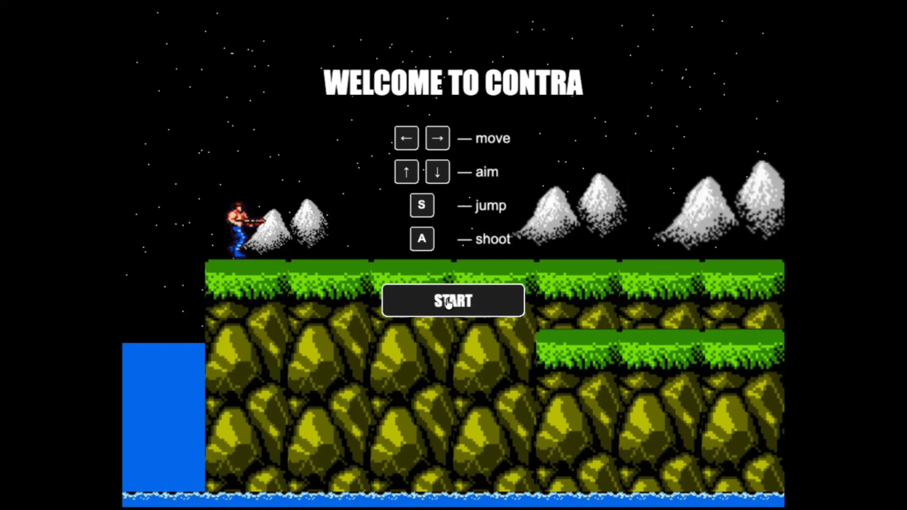

# Contra

A browser run-and-gun in the spirit of the jungle stage: side-scroll, platforms, turrets, a spread gun, and a boss.

[](https://geraldikus.github.io/Contra/)


<p align="center">
  <a href="https://geraldikus.github.io/Contra/">
    
  </a>
</p>

<p align="center">
  <a href="https://geraldikus.github.io/Contra/"><strong>Play the live demo</strong></a>
</p>

Built with PixiJS and Vite. Rendering, input, physics, and the level are custom — there is no game-engine physics layer.

## Play

| | Desktop | Phone |
| --- | --- | --- |
| Move | `←` `→` | Joystick |
| Aim | `↑` `↓` | Joystick |
| Jump | `S` | Jump |
| Shoot | `A` | Shoot |

On a phone the game runs in portrait. In landscape it asks you to rotate the device. The first screen shows the same controls before the level starts.

Shoot the crates. A spread gun drops out and replaces the default rifle until you die. Falling into water or leaving the screen ends the run. The camera only scrolls forward.

## Stack

| | |
| --- | --- |
| Language | JavaScript, ES modules, private fields |
| Render | [PixiJS 8](https://pixijs.com/) — canvas, sprites, animated sprites, ticker at 60 FPS |
| Build | [Vite 8](https://vite.dev/) |
| Hosting | GitHub Actions → GitHub Pages (`base: "/Contra/"`) |
| Physics | Custom AABB, gravity, one-way platforms |
| Input | Keyboard, plus DOM joystick and buttons on touch devices |

## How it is put together

The loop lives in `src/Game.js` and runs from the Pixi ticker. Each object is an `Entity` with a separate view: logic does not draw itself.

- **Factories** spawn the hero, platforms, bullets, enemies, and pickups. `SceneFactory` lays out the level on a 128px grid.
- **Weapons** use two strategies on one `Weapon` class: a single shot and a five-bullet spread.
- **Camera** follows the hero on X and does not scroll back.
- **World** is three Pixi containers: background, game, foreground.
- **Collisions** separate horizontal and vertical hits, so the hero can land on a platform instead of sticking to its side.
- **Touch controls** are HTML elements. They press the same keys as the keyboard through `KeyboardProcessor`, so gameplay code stays one path.

```text
src/
  Game.js                 loop, damage, level flow
  Physics.js              AABB
  Camera.js               forward-only scroll
  Weapon.js               rifle / spread gun
  SceneFactory.js         level layout
  Entities/
    Hero/                 movement, states, aim
    Enemies/Runner/       soldiers, turrets, boss
    Platforms/            ground, water, falling bridges
    Bullets/              hero and enemy shots
    Powerups/             crates and the spread gun
  Onboarding/             start screen
  TouchControls/          joystick and buttons
```

Enemies are running soldiers, static turrets, and a boss with two guns. Bridges collapse once the hero runs past them.

## Run locally

Node 20.

```bash
npm install
npm run dev
```

| Script | |
| --- | --- |
| `npm run dev` | Dev server |
| `npm run build` | Production build in `dist/` |
| `npm run preview` | Serve the production build |

A push to `main` builds the project and deploys `dist/` with GitHub Actions (`.github/workflows/deploy.yml`).

## Note

Unofficial study project. Not affiliated with Konami. Assets and the Contra name belong to their owners.
